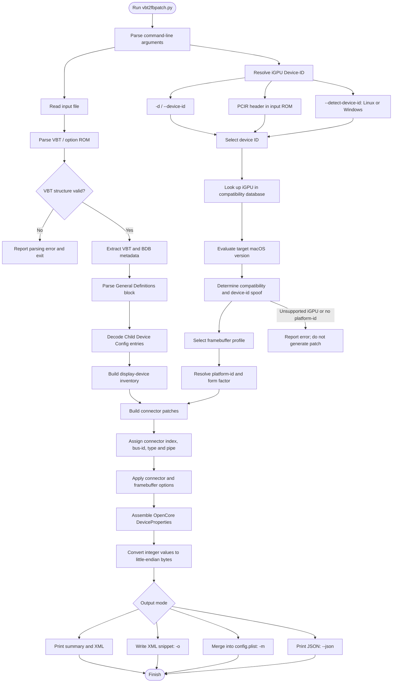

# vbt2fbpatch – Processing Workflow

This document explains how `vbt2fbpatch.py` turns an Intel Video BIOS Table (VBT) dump into an OpenCore `DeviceProperties` framebuffer patch.

The workflow follows the current script structure. It covers the two main analysis paths—VBT connector parsing and iGPU compatibility resolution—and shows where they converge during patch generation.

## Diagram

## Stages

### 1. Input and VBT parsing

The script accepts a VBT dump or an option ROM containing a VBT through the required `-i` / `--input` argument.

**The parser**:

1. Reads the input file as binary data.
2. Locates and validates the VBT structure.
3. Reads the VBT header and locates the BIOS Data Block (BDB).
4. Reads the BDB version and its block table.
5. Parses BDB block 2, **General Definitions**.
6. Reads the `Child Device Config` entries using the layout appropriate for the BDB version.
7. Decodes the display-device fields and builds the port inventory.

**The decoded information includes, where available**:

- Device handle and connector classification (for example, internal panel or external display).
- DVO port and its corresponding DDI.
- Device-type flags.
- AUX channel, DDC pin and I2C pin.
- HPD status and inversion.
- USB-C, Thunderbolt and LSPCON indicators.

BDB-version gates matter: some fields are only defined in newer BDB versions. The parser records the checksum status and can report parser notes and warnings; a checksum mismatch is not represented as a separate mandatory stop in the main workflow.

### 2. iGPU identification and compatibility

The script needs the **real Intel iGPU PCI Device-ID** to select an appropriate compatibility entry. It resolves the ID in this order:

1. `-d` / `--device-id`, when supplied.
2. A Device-ID found in a PCIR header in the input option ROM.
3. `--detect-device-id`, when requested and supported by the host operating system.

Automatic system detection is supported on Linux and Windows. It is deliberately unavailable on macOS because macOS may report an already-injected (spoofed) Device-ID rather than the hardware's original ID.

The resolved ID is checked against the script's built-in iGPU database, which contains architecture, supported macOS range, spoof information and framebuffer profiles. The target macOS version (`-t`) is considered during resolution.

**The result determines**:

- Whether the iGPU is natively supported, needs a Device-ID spoof, is unsupported, or is unknown.
- Whether a spoof is required for the selected macOS version.
- Which framebuffer profiles are available.
- Which form factor to use: desktop, mobile or headless.

By default, the form factor is mobile when the VBT contains an internal panel; otherwise it is desktop. `-f` can override this. `--mobile` selects mobile mode and limits connector patches to three.

The optional `-p` / `--platform-id` overrides automatic framebuffer selection. `--spoof-id` can override the database's suggested spoof target.

### 3. Connector mapping

Unless the resolved form factor is headless, the script converts the parsed VBT display devices into framebuffer connector patches.

**The mapping process**:

1. Ignores analog, MIPI and unknown connector types.
2. Prioritizes the internal panel, then sorts external connectors by DDI.
3. Assigns the internal panel bus-id `0` and pipe `8`.
4. Derives external bus-IDs from the DDI by default. `--bus-id-source ddc` optionally uses eligible legacy GMBUS DDC pins.
5. Assigns connector types and pipes according to the selected mapping rules.
6. Applies connector index, connector-count and pipe overrides where requested.
7. Reports skipped devices, duplicate or unverified bus-IDs, and connectors that exceed the available slots.

The normal maximum is four framebuffer connectors (`con0`–`con3`). Mobile mode limits the generated set to three (`con0`–`con2`). The default first connector index is `0` when an internal panel is present and `1` otherwise; `--first-con` can override it.

### 4. Optional properties and flags

The script combines the automatically resolved properties with optional user-requested settings.

| Option | Effect |
|---|---|
| `--unifiedmem` | Adds `framebuffer-unifiedmem`. |
| `--rps-control` | Adds `rps-control`. |
| `--backlight-fix` | Adds the FAQ-based backlight register fix when applicable; the selected property depends on the iGPU and macOS version. |
| `--con-flags` | Overrides connector flags for external connectors. |
| `--fb-flags` | Overrides framebuffer flags. |
| `--lspcon-mode` | Sets the preferred LSPCON mode for VBT-marked LSPCON connectors. |
| `--pipe` | Overrides the pipe value for every generated connector. |
| `--mobile` | Uses mobile mode, limits connectors to three and sets `framebuffer-portcount` to three. |

Connector flags are otherwise taken from the selected framebuffer's known defaults where available. The script also adds the LSPCON support properties when the VBT identifies an LSPCON connector.

### 5. OpenCore property generation

Once compatibility resolution and connector mapping are complete, the script assembles an ordered property dictionary for:

`PciRoot(0x0)/Pci(0x2,0x0)`

Depending on the resolved device and selected options, this can include:

- `AAPL,ig-platform-id`
- `device-id` (only when a spoof is required)
- Additional iGPU properties
- `framebuffer-patch-enable`
- Framebuffer flags and port count
- `framebuffer-conN-enable`
- `framebuffer-conN-busid`
- `framebuffer-conN-type`
- `framebuffer-conN-pipe`
- Optional connector flags and LSPCON properties

Integer values are converted to four-byte little-endian data through the script's shared packing helper. The values are kept as integers until serialization, avoiding repeated byte swapping.

### 6. Output

The script supports four output paths:

| Option | Result |
|---|---|
| Default | Prints the VBT/port summary, compatibility result, warnings, connector table and OpenCore XML snippet to the terminal. |
| `-o` / `--output` | Writes the XML snippet to a file. |
| `-m` / `--merge` | Merges the generated properties into an existing `config.plist`, first creating a `.bak` backup. |
| `--json` | Prints machine-readable JSON containing VBT metadata, ports, compatibility results, connectors, generated properties, warnings and any error. |

When `--json` is selected, the script returns the JSON result directly rather than following the normal terminal-summary/XML output path.

## Error handling

The main workflow stops when the input cannot be read or parsed, when no usable Device-ID can be resolved, when an argument combination is invalid, or when no platform-id can be selected. An iGPU explicitly marked unsupported does not receive a generated framebuffer patch.

Warnings are also collected for conditions that do not necessarily stop generation—for example, ignored VBT entries, uncertain bus-ID mappings, connector limits, or optional settings that do not apply.

## Reference implementation

- [WhateverGreen Intel HD Graphics FAQ](https://github.com/acidanthera/WhateverGreen/blob/master/Manual/FAQ.IntelHD.en.md)
- [Linux i915 VBT definitions](https://github.com/torvalds/linux/blob/master/drivers/gpu/drm/i915/display/intel_vbt_defs.h)
- [Linux i915 VBT parser](https://github.com/torvalds/linux/blob/master/drivers/gpu/drm/i915/display/intel_bios.c)
