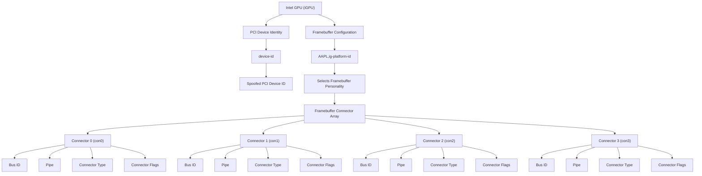

# Understanding Intel Framebuffer Configuration

:construction: WORK IN PROGRESS

## Introduction

Intel framebuffer configuration determines how macOS initializes the integrated GPU (iGPU) and handles connected displays. It combines a selected framebuffer personality with a set of connector definitions that describe how displays are connected to the iGPU.

Correctly configuring these properties is essential for getting internal displays and external video outputs working reliably on a Hackintosh.

This document explains the relevant DeviceProperties, the structure of framebuffer connector entries, and how `vbt2fbpatch` uses the system's Video BIOS Table (VBT) to help identify the required connector information.

## Intel Framebuffer DeviceProperty Hierarchy

The following diagram illustrates the relationship between GPU identification, framebuffer selection and the individual connector entries.



A framebuffer personality can contain up to four connector entries, indexed from `0` to `3`. Not every personality uses all four entries.

## Working Principle

`AAPL,ig-platform-id` and `device-id` configure how macOS identifies and initializes the Intel integrated GPU, while the framebuffer connector properties describe the individual display outputs within the selected framebuffer personality.

These properties serve different purposes:

- `AAPL,ig-platform-id`: Selects the framebuffer personality used by macOS.
- `device-id`: Changes the PCI device identity presented to macOS.
- `framebuffer-conX-*`: Modifies individual connector entries through WhateverGreen.

## AAPL,ig-platform-id Specifics

`AAPL,ig-platform-id` selects the Intel framebuffer personality used by macOS to initialize and configure the integrated GPU.

The selected platform ID determines the framebuffer configuration, including connector definitions, display routing and memory-related parameters.

- **Native platform ID:** Use the platform ID corresponding to your actual iGPU when it is supported by macOS.
- **Compatible platform ID:** If the native framebuffer is unsuitable or incompatible, another platform ID from a compatible Intel GPU generation may be used.
- **Framebuffer patching:** Individual connector properties can be modified without replacing the entire framebuffer personality.

Unlike `device-id`, which changes the PCI device identity presented to macOS, `AAPL,ig-platform-id` selects the framebuffer implementation.

> [!IMPORTANT]
> 
> A compatible platform ID must match the actual GPU architecture and hardware capabilities. Simply selecting a platform ID from a newer or more powerful iGPU does not add unsupported hardware features.

## Device-ID Specifics

If the iGPU integrated into your CPU is natively supported by your macOS version, injecting a `device-id` is generally unnecessary.

If the iGPU is not natively recognized, you can inject a compatible `device-id` from another supported GPU, preferably from the same or a closely related CPU generation. This is known as a **device-ID spoof**.

The same principle applies when running an older macOS version that does not officially support your CPU generation and its integrated GPU. In such cases, additional spoofing may be required:

- **CPU-ID spoof:** Makes macOS identify the processor as a supported CPU generation.
- **iGPU device-ID spoof:** Makes macOS identify the integrated GPU as a supported graphics device.

> [!IMPORTANT]
> 
> A device-ID spoof alone does not add missing hardware capabilities or guarantee graphics acceleration. The selected framebuffer personality and any required patches must also be compatible with the actual GPU hardware.

## Relevant DeviceProperties

### GPU Identification and Framebuffer Selection

| Property | Level | Function |
|---|---|---|
| `device-id` | GPU | Spoofs the PCI device ID presented to macOS. |
| `AAPL,ig-platform-id` | Framebuffer | Selects the Intel framebuffer personality. |

> [!NOTE]
> 
> Device-ID injection is optional and depends on the hardware configuration and macOS compatibility.

### Connector Properties

A framebuffer personality contains an array of connector entries. Each entry describes a display connection from the perspective of the macOS graphics driver.

WhateverGreen provides individual patch properties to modify these entries:

| Property | Description |
|---|---|
| `framebuffer-conX-enable` | Enables patching of connector slot `X`. |
| `framebuffer-conX-index` | Selects the connector index in the framebuffer array that should be modified. |
| `framebuffer-conX-busid` | Specifies the GMBUS/DDC bus identifier used for display communication and detection. |
| `framebuffer-conX-pipe` | Specifies the pipe value associated with the connector. Its precise interpretation can depend on the GPU generation and framebuffer implementation. |
| `framebuffer-conX-type` | Defines the connector type presented to macOS, such as DisplayPort, HDMI or eDP. |
| `framebuffer-conX-flags` | Contains connector-specific flags that influence how the framebuffer handles the connection. |

`X` represents the connector's patch slot. For example, `framebuffer-con0-*` configures patch slot 0, while `framebuffer-con0-index` determines which framebuffer connector entry that patch targets.

The connector index and the patch slot are therefore not necessarily the same.

> [!NOTE]
> 
> On laptops, `con0` is commonly assigned to the internal display (eDP or LVDS). However, this is not universal and depends on the framebuffer personality and the platform's display wiring. Always verify the actual connector mapping using the VBT and hardware information.

### Connector Type

The connector type tells macOS how to treat a framebuffer output. Common values include:

| Connector | Value (hex) | Data representation |
|---|---:|---|
| Dummy | `0x00000001` | `01000000` |
| LVDS / eDP | `0x00000002` | `02000000` |
| Digital DVI | `0x00000004` | `04000000` |
| DisplayPort | `0x00000400` | `00040000` |
| HDMI | `0x00000800` | `00080000` |

The values in the final column show how the 32-bit values are represented in little-endian form in OpenCore DeviceProperties.

The connector type does not necessarily identify the physical socket. For example, a physical USB-C port carrying DisplayPort video may be represented as a DisplayPort connector in the framebuffer.

### Bus ID

The Bus ID identifies the GMBUS/DDC interface associated with a connector. It is relevant to display detection and communication, including reading display information such as EDID.

Common Bus ID values include `0x04`, `0x05` and `0x06`. They are not universal identifiers for physical HDMI or DisplayPort sockets: the correct assignment depends on the platform's display wiring and firmware configuration.

### Pipe

The pipe value is another field in the connector entry. It specifies the display pipe associated with the connector.

Its precise interpretation and valid values depend on the Intel GPU generation and framebuffer implementation. It should not be confused with the separate `framebuffer-pipecount` property.

### Flags

Connector flags are a bit field containing additional connector-specific settings. Individual bits can affect framebuffer behavior, but their meaning is not fully documented for every Intel generation.

Avoid copying flag values from unrelated framebuffer configurations without understanding the hardware and the intended patch.

## What is VBT.bin?

VBT stands for **Video BIOS Table**. It is a firmware-provided data structure containing platform- and board-specific configuration information for Intel graphics. Much of this information concerns the display hardware and its connections.

The VBT can contain information about the system's display topology, including port configuration and the interfaces used for display communication. It is therefore a valuable reference when investigating how a laptop's internal panel and external video outputs are wired.

### Why Use the VBT?

A framebuffer dump shows the connector configuration provided by a macOS framebuffer personality. It does not necessarily tell you how the laptop's physical display outputs are wired.

The VBT provides a second, firmware-level source of information that can help bridge that gap.

For example, it can provide information about:

- Display port assignments and connection types.
- DDC configuration used for display detection.
- AUX channel assignments for DisplayPort connections.
- Display routing and other platform-specific configuration parameters.

The VBT is not an OpenCore configuration file, nor does it directly provide a ready-to-use macOS framebuffer patch. Its data must be interpreted in the context of the selected framebuffer personality and verified against the actual hardware.

## How vbt2fbpatch Uses the VBT

`vbt2fbpatch` uses the extracted `VBT.bin` as an input to identify hardware-specific display connection information.

It analyzes relevant VBT structures and evaluates the extracted information alongside the selected macOS framebuffer personality to help determine suitable connector properties, including:

- Connector assignments and mappings.
- Bus ID.
- Pipe data.
- Connector type.

Not every framebuffer property is directly represented in the VBT. Some values must be derived or interpreted using the framebuffer structure and additional technical references.

The resulting information helps identify the appropriate connector modifications for an OpenCore framebuffer patch.

**In short:** The VBT helps identify the hardware's display connections; the framebuffer personality defines the available connector entries; and WhateverGreen connector properties modify how macOS handles those connections.

## OpenCore Configuration Example

The following illustrates where the relevant properties are located in an OpenCore configuration.

```text
DeviceProperties
└── Add
    └── PciRoot(0x0)/Pci(0x2,0x0)
        ├── AAPL,ig-platform-id
        ├── device-id
        │
        ├── framebuffer-con0-enable
        ├── framebuffer-con0-index
        ├── framebuffer-con0-busid
        ├── framebuffer-con0-pipe
        ├── framebuffer-con0-type
        └── framebuffer-con0-flags
```

The example shows one connector patch. Additional connector patches can be configured for slots `1`, `2` and `3` as required.

The `device-id` property is optional, and the connector properties should only be injected when the corresponding modifications are necessary.